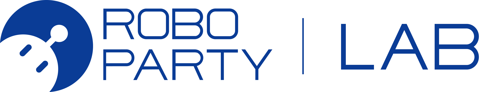

<h1 align="center">
  P-BFM: Perceptive Behavioral Foundation Models for Humanoid Control via Unsupervised Reinforcement Learning
</h1>

<p align="center">
  <a href="https://roboparty.github.io/P-BFM/"></a>
  <a href="https://roboparty.github.io/P-BFM/#overview"></a>
  <a href="https://arxiv.org/abs/2610.15833"></a>
  <a href="https://roboparty.github.io/P-BFM/interactive/"></a>
</p>

<p align="center">
  <a href="README.md">English</a> | <a href="README_zh-CN.md">中文</a>
</p>

<p align="center">
  
  &nbsp;&nbsp;&nbsp;&nbsp;
  <a href="https://lab.roboparty.com/"></a>
</p>

P-BFM 将**动作参考、目标身体状态与奖励函数**映射到共享的行为意图空间。策略结合行为意图、深度感知及显式航向和速度指令，在不同地形上执行全身动作。

论文中的 G1 实验使用 **40 条平地 LaFAN 动作序列和在线地形交互**，不依赖地形专属的动作示范。本版本提供 G1 的训练和推理实现。

[训练与配置](docs/TRAINING.md) · [推理与部署](docs/INFERENCE.md) · [代码结构](docs/ARCHITECTURE.md)

## 支持的机器人

本版本支持 **29 个可控关节的 Unitree G1**，使用
[`g1_29dof.yaml`](pbfm/configs/robots/g1_29dof.yaml)、G1 重定向 LaFAN 动作
和 8 × 18 × 32 深度输入。推理与导出沿用训练记录中的关节顺序、控制参数和相机标定。

## 安装

依赖 Python 3.10、MJLab 1.4、MuJoCo 3.8 和 PyTorch 2.7。在仓库根目录运行：

```bash
uv sync --extra test
```

保存视频还需要 `PATH` 中有 `ffmpeg`，可用 `ffmpeg -version` 检查。

G1 可通过以下命令下载两份 LaFAN PKL，保存到 `pbfm/data/`：

```bash
bash scripts/download_data.sh
```

使用其他 G1 重定向数据集时，请参阅[动作数据要求](docs/TRAINING.md#motion-data)。

## 训练

使用8张可用GPU，并按实际机器修改缓存、数据及输出路径：

```bash
export PYTHONPATH="$PWD${PYTHONPATH:+:$PYTHONPATH}"
export OMP_NUM_THREADS=1 MUJOCO_GL=egl NCCL_NVLS_ENABLE=0
export UFO_CACHE_DIR=/path/to/writable-disk/pbfm-cache
```

### G1

```bash
uv run python -m torch.distributed.run --standalone --nnodes=1 --nproc_per_node=8 \
  scripts/train_legacy_scratch.py --gpu-ids single --terrain-mode training_mix \
  --robot-config pbfm/configs/robots/g1_29dof.yaml \
  --num-envs 1024 --num-env-steps 192020480 --seed 4831 \
  --data-path pbfm/data/lafan_29dof_10s-clipped.pkl \
  --work-dir /path/to/new-g1-run
```

该命令从头训练，总计192,020,480全局步，地形课程从第0步计时。Replay 保存在 CPU 内存中，启动前需确认主机内存与磁盘容量。追加 `--smoke` 并使用独立的新输出目录可进行短测：32,768全局步、减少环境和 replay 容量。命令不会自动等待空卡或停止已有任务。

使用 W&B 时先单独登录，再追加 `--use-wandb`。网络大小、G1 的奖励／DR、课程和checkpoint要求见[训练指南](docs/TRAINING.md)。

## 推理与部署

G1 提供三个推理入口，沿用训练目录保存的标定：

```bash
uv run python -m pbfm.inference.tracking --help
uv run python -m pbfm.inference.goal --help
uv run python -m pbfm.inference.reward --help
```

Tracking 支持参考动作、地形及相机设置；goal 推理使用匹配的 G1 动作数据中的目标帧。与tracking、goal及模型导出不同，计算新的reward latent需要replay样本。

```bash
uv run python -m scripts.export_depth_policy_onnx \
  --checkpoint /path/to/run/checkpoint --output /path/to/export/policy.onnx
uv run python -m scripts.export_backward_encoder_onnx \
  --model-folder /path/to/run --output /path/to/export/backward_encoder.onnx --device cpu
```

这里的 `policy.onnx` 包含**深度编码器、速度估计器、观测归一化和Actor**，不是只含动作网络的split模型。部署时必须使用匹配的机器人标定和完整context，包括heading／velocity指令及其有效标志。示例、深度预处理和校验方法见[推理指南](docs/INFERENCE.md)。

## 开发与验证

```text
pbfm/    共享算法、训练、仿真、机器人配置／资产及推理
scripts/ 训练与导出命令
tests/   回归测试与小型测试数据
docs/    配置、架构及部署指南
```

```bash
PYTHONPATH=. uv run python -m pytest tests
```

依赖外部数据或 GPU 的测试会在资源缺失时跳过。测试覆盖训练配置、参考动作处理、回放、奖励、checkpoint 加载、推理与 ONNX 导出。GPU rollout 和 reset 检查需显式启用，详见[训练指南](docs/TRAINING.md#tests-and-validation)。

## 致谢

PBFM 基于 [UFO](https://github.com/Roboparty/UFO)，保留上游声明及 CC BY-NC 4.0 [许可证](LICENSE)。

## 项目与交流

- 项目主页与演示：https://roboparty.github.io/P-BFM/
- 论文：https://arxiv.org/abs/2610.15833
- 团队：[RoboPartyLab](https://lab.roboparty.com/)
- 联系邮箱：[xuewangusst@gmail.com](mailto:xuewangusst@gmail.com)
- 如需加入交流群，请添加微信 **15251239451**。

## 仓库分支

- `main`：PBFM运行代码与机器人配置。
- `pages`：项目网站、论文、图片和演示视频；GitHub Pages从该分支根目录发布。

网站修改与代码修改分别提交，不混入同一发布分支。
